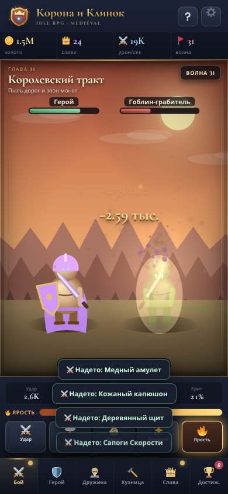
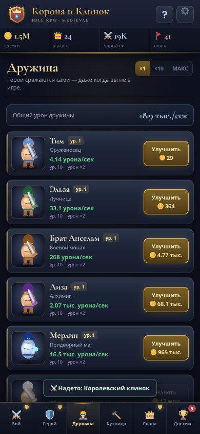
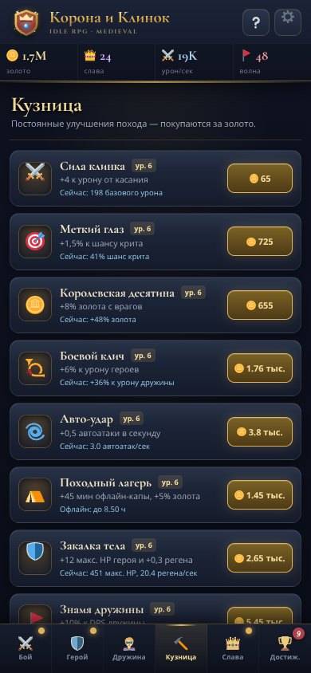
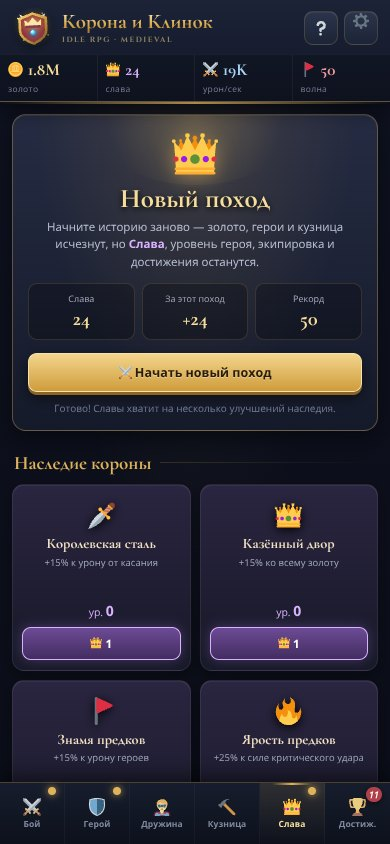
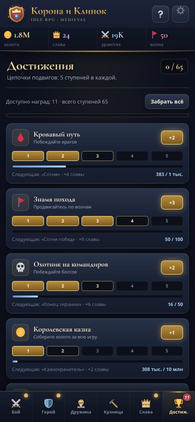
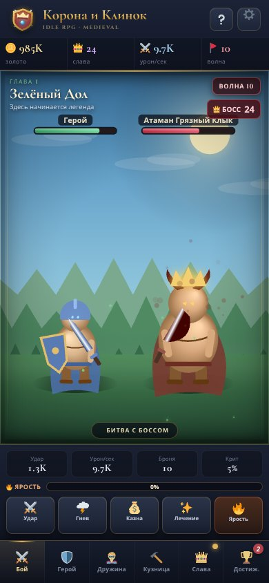
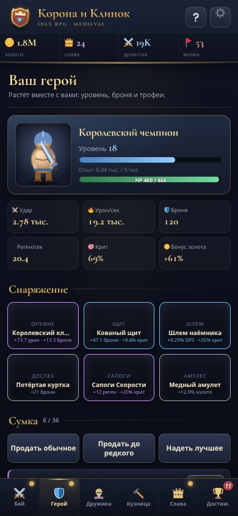

# Корона и Клинок

**Мобильная idle RPG в средневековом сеттинге.** Чистый TypeScript + Vite, без игровых движков и серверной части. Бой идёт сам, персонаж качается и собирает трофеи, а игра **обновляется по воздуху с GitHub** — APK переустанавливать не нужно. Работает в браузере телефона, ставится как PWA и полностью играется без интернета.



|  |  |  |
| --- | --- | --- |
|  |  |  |

---

## 📱 Запуск на телефоне — начните здесь

**Два готовых файла — просто скачайте на телефон:**

1. 📦 **[`download/corona-i-klinok.apk`](download/corona-i-klinok.apk)** (~500 КБ, v2.0.1) —
   настоящее Android-приложение. Откройте файл в «Файлах», разрешите установку
   из неизвестных источников → иконка «Корона и Клинок» появится среди приложений.
2. 🌐 **[`mobile/Корона_и_Клинок.html`](mobile/Корона_и_Клинок.html)** (~730 КБ) —
   вся игра в одном файле: JS, CSS, шрифты и иконки внутри. Откройте в Chrome
   через «Файлы». Интернет не нужен.

> Если вы открываете `index.html` из корня и видите пустую страницу — это
> исходник для сборщика Vite, а не игра. Нужны `mobile/`, `dist/` или APK.

| Нужно | Куда идти |
| --- | --- |
| **Установить APK** | [download/corona-i-klinok.apk](download/corona-i-klinok.apk) → [инструкция](MOBILE_INSTALL.md#вариант-3--настоящий-apk) |
| Просто поиграть офлайн без установки | [MOBILE_INSTALL.md](MOBILE_INSTALL.md), вариант 1 |
| Иконка на главном экране, fullscreen PWA | [MOBILE_INSTALL.md](MOBILE_INSTALL.md), вариант 2 |
| Пересобрать APK | [`android/README.md`](android/README.md) и [`docs/github-actions-example.yml`](docs/github-actions-example.yml) |
| Выпустить обновление по воздуху | [`docs/OTA.md`](docs/OTA.md) |

APK собран из [`android/`](android/) — минимальная нативная обёртка на `WebView`
без зависимостей: игра лежит в `assets/`, прогресс пишется в `SharedPreferences`,
интернет не используется. Подпись проверена схемами v1/v2/v3, `minSdk 21`,
`targetSdk 34`, `resources.arsc` выровнен. Пересобрать можно командой
`bash android/build-apk.sh` (Termux / Linux с Android SDK / CI), через Android
Studio или автоматически в GitHub Actions.

```bash
npm run build:mobile   # пересобрать mobile/ и android/app/src/main/assets/index.html
npm run build:apk      # пересобрать download/corona-i-klinok.apk
npm run release -- 2.0.2 "Описание"   # НОВАЯ ВЕРСИЯ: собрать и опубликовать OTA
```

---

## 🆕 Версия 2.0 — не кликер, а idle RPG

- **Живая графика без SVG и без картинок.** Все персонажи, монстры, фон,
  облака, пыль, искры и логотип рисуются процедурно на Canvas в реальном
  времени: дыхание, шаг, удар, получение урона, смерть, появление. Враги
  **атакуют героя в ответ** — у него есть HP, броня, регенерация и возрождение.
- **Настоящий автобой.** Герой и дружина сражаются сами, касание лишь
  ускоряет. Умения применяются автоматически (можно выключить в настройках).
- **Прокачка персонажа.** Опыт, уровни, 6 слотов экипировки, 4 редкости
  предметов, лут с монстров, инвентарь, авто-надевание лучшего и продажа.
  Экипировка сохраняется при новом походе.
- **13 цепочек достижений по 5 ступеней** (65 наград) вместо 19 одиночных.
  Прогресс считается из пожизненной статистики, награды забираются по порядку
  или все сразу.
- **OTA‑обновления.** Приложение само проверяет `ota/manifest.json` на GitHub,
  скачивает свежий HTML, показывает баннер «Вышла версия X» и применяет его
  после перезапуска. Прогресс защищён отдельным хранилищем и резервной копией.
- **Новый дизайн.** Карточки с объёмом вместо плоских рамок, исправлена
  вёрстка кузницы (кнопка больше не уезжает), добавлена вкладка «Герой».
  Проверено на ширине 360–430 px.

Подробности об обновлениях: [`docs/OTA.md`](docs/OTA.md).

---

## Что внутри

- **Бой.** Герой и дружина бьют автоматически, монстр отвечает. Криты, всплывающий урон, искры, тряска экрана, полоски HP у обоих. Каждые 10 волн — босс с таймером 30 секунд.
- **8 локаций** со сменой пейзажа и бестиария: Зелёный Дол → Королевский тракт → Склеп предков → Огненные пустоши → Ледяной перевал → Проклятый лес → Трон Тьмы → Логово Дракона. Локации повторяются кругами с повышенной сложностью.
- **8 наёмных героев** с живыми анимированными портретами, стоимостью и бонусами ×2 на каждом рубеже уровней. Покупка ×1 / ×10 / «максимум».
- **8 улучшений кузницы**: сила клинка, криты, золото, урон дружины, автоудары, офлайн-лагерь, закалка тела и знамя дружины.
- **4 умения** с перезарядкой (включая лечение) + **шкала ярости**: ×2 ко всему урону на 15 секунд. Авто-применение.
- **13 цепочек достижений × 5 ступеней** с наградой в 👑 Славе и подробной летописью статистики.
- **Престиж «Новый поход»** с 25-й волны: сброс золота/героев/кузницы за Славу и 6 постоянных перков наследия. Уровень героя, предметы и достижения сохраняются.
- **Офлайн-прогресс** до 4 часов (увеличивается улучшением лагеря): дружина сражается, пока игры нет на экране.
- **Автосохранение** каждые 10 секунд, экспорт/импорт сохранения кодом, сброс прогресса, настройки звука и эффектов.
- **Звук** на Web Audio API (синтезируется на лету, без аудиофайлов).
- **PWA**: манифест, иконки всех размеров, service worker с предкэшированием JS/CSS/шрифтов/иконок. Полностью офлайн.
- Вся графика — **живой Canvas‑рендер** (никаких SVG и растровых картинок); иконки интерфейса — локальные SVG Twemoji. Игра не делает сетевых запросов, кроме проверки обновлений на GitHub.

---

## Быстрый старт

Нужен Node.js 20.19+ (проверено на 22).

```bash
npm install
npm run dev          # http://localhost:5173
```

Откройте адрес на телефоне в той же сети или используйте режим устройства в devtools. Интерфейс рассчитан на портретный экран 360–430 px, но аккуратно центрируется и на десктопе.

### Сборка

```bash
npm run build        # tsc --noEmit && vite build  →  dist/
npm run preview      # проверить production-сборку: http://localhost:4173
npm run typecheck    # только проверка типов
npm run icons        # пересобрать SVG-иконки эмодзи (после правки исходников)
npm run build:mobile # один автономный HTML + ассет для APK
npm run build:apk    # собрать и подписать APK (нужен Android SDK или Termux)
npm run build:ota    # собрать mobile/ + ota/game.html + ota/manifest.json
npm run release -- 2.0.2 "Описание"   # поднять версию и опубликовать обновление
```

`dist/` — статическая папка: заливайте её на любой хостинг (GitHub Pages, Netlify, Cloudflare Pages, обычный nginx). Пути в сборке относительные (`base: './'`), поэтому игра работает и из подпапки.

---

## Установка на телефон

**Android / Chrome:** откройте игру → меню ⋮ → «Установить приложение» или «Добавить на главный экран».

**iOS / Safari:** откройте игру → «Поделиться» → «На главный экран».

> Service worker требует HTTPS (или `localhost`). На GitHub Pages это выполняется автоматически. После установки игра запускается в полноэкранном режиме без адресной строки.

### Если нужен APK / AAB для магазина

Проект уже PWA, поэтому проще всего обернуть готовую сборку:

1. **PWABuilder** — задеплоьте `dist/`, откройте [pwabuilder.com](https://www.pwabuilder.com), вставьте URL и сгенерируйте подписанный APK/AAB.
2. **Capacitor** — полноценная нативная обёртка:

   ```bash
   npm i -D @capacitor/cli @capacitor/core @capacitor/android
   npx cap init "Корона и Клинок" com.example.crownandblade --web-dir dist
   npx cap add android
   npm run build && npx cap sync
   npx cap open android     # further build in Android Studio
   ```

3. **Trusted Web Activity / Bubblewrap** — тонкая обёртка вокруг уже установленного PWA.

Специально для нативных обёрток в коде нет обращений к `localhost`, все ресурсы относительные, а сохранения лежат в `localStorage`.

---

## Как играть

| Вкладка | Что делать |
| --- | --- |
| ⚔️ **Бой** | Бить врага касанием, применять умения, копить и активировать ярость. |
| 🦸 **Герои** | Нанимать соратников — они дают урон в секунду, в том числе офлайн. |
| 🔨 **Кузница** | Усиливать касание, крит, добычу золота, автоатаки и офлайн-лимит. |
| 👑 **Слава** | Тратить Славу на постоянные перки и начинать «Новый поход». |
| 🏆 **Достиж.** | Забирать Славу за выполненные подвиги и смотреть летопись. |

Горячие клавиши на десктопе: `1`–`5` — переключение вкладок, `Esc` — закрыть окно.

### Баланс (для тех, кто будет дорабатывать)

Формулы собраны в `src/game/data.ts` и `src/game/engine.ts`:

- HP волны: `10 · 1.155^(w-1) · (1 + 0.055(w-1))`, босс ×4.2, новый круг ×1.45.
- Награда: `5 · 1.135^(w-1) · (1 + 0.045(w-1))`, босс ×3.5.
- Герой: урон `baseDps · ур. · 1.055^ур. · 2^(достигнутые рубежи)`, цена `baseCost · 1.135^ур.`
- Касание: базовый урон кузницы `+ 25% от урона героев`, поэтому активная игра остаётся полезной всегда.
- Слава за поход: `floor((волна - 9)^1.3 / 5)`.

---

## Архитектура

```
index.html                 оболочка, метатеги PWA
public/
  manifest.webmanifest    манифест приложения
  sw.js                   service worker (предкэш + cache-first)
  icons/                  иконки приложения + SVG-иконки эмодзи
src/
  main.ts                 каркас, вкладки, игровой цикл (rAF), события
  game/
    types.ts              все типы состояния и контента
    data.ts               локации, враги, герои, кузница, перки, достижения
    engine.ts             формулы баланса, бой, офлайн-симуляция, покупки, престиж
    state.ts              localStorage, валидация сейва, экспорт/импорт
    format.ts             компактные числа и время
    audio.ts              звуковые эффекты на Web Audio
  art/
    creatures.ts          процедурные SVG персонажей и врагов
    backdrop.ts           процедурные SVG фоны локаций
    colors.ts             работа с цветом
    icons.ts              авто-сгенерированная карта эмодзи → SVG
  ui/
    common.ts             экраны, модалки, тосты, шапка
    battle.ts             арена, эффекты, умения, ярость
    panels.ts             герои / кузница / слава / достижения
    modals.ts             настройки, помощь, первое знакомство
  styles/                 base / battle / panels / effects
scripts/
  make_icons.py           генератор PNG-иконок без внешних библиотек
  prepare-emoji.mjs       копирование нужных Twemoji SVG в public/
docs/screenshots/         скриншоты для документации
docs/github-actions-example.yml  готовый CI-воркфлоу (шаблон)
```

Игровое состояние — один объект `GameState`. Цикл `requestAnimationFrame` крутит `game.tick(dt)`, UI обновляется 10 раз в секунду; эффекты и звук идут через шину событий `game.on(...)`. Сохранение автоматическое и при уходе с вкладки.

---

## CI и деплой

Готовый воркфлоу лежит в `docs/github-actions-example.yml`: он ставит зависимости,
выполняет `npm run build`, сохраняет `dist/` артефактом и (для `main`) публикует
сборку на GitHub Pages. Чтобы включить его, скопируйте файл в репозиторий:

```bash
mkdir -p .github/workflows
cp docs/github-actions-example.yml .github/workflows/build.yml
```

> Файл намеренно хранится как шаблон, чтобы сборка репозитория не зависела от
> permission `workflows` у токена автоматизации: GitHub отклоняет пуш в
> `.github/workflows/` без этого права. Воркфлоу включается вручную одной командой.

---

## Сохранения

Ключ `localStorage`: `corona-i-klinok-save-v1`. Формат версионируется и при загрузке проходит через `normalise()` — битые или старые сейвы не роняют игру. В настройках есть экспорт/импорт строкой Base64 (удобно переносить прогресс между устройствами).

---

## Благодарности и лицензии

- Иконки эмодзи — [Twemoji](https://github.com/twitter/twemoji), **CC-BY 4.0**. Подробнее — [THIRD_PARTY_NOTICES.md](THIRD_PARTY_NOTICES.md).
- Шрифты [Cormorant Garamond](https://fonts.google.com/specimen/Cormorant+Garamond) и [Cinzel](https://fonts.google.com/specimen/Cinzel) — **SIL Open Font License 1.1**, поставляются через `@fontsource/*`.
- Вся остальная графика (персонажи, фоны, иконка приложения) сгенерирована кодом этого проекта.

Игра сделана как самодостаточный pet-проект — без телеметрии, рекламы и внешних запросов.
